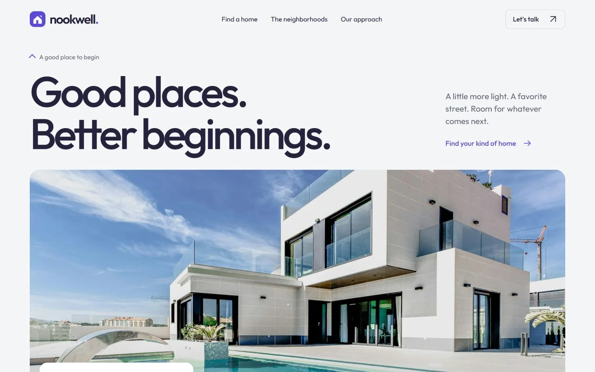

# Nookwell — free real estate website template

A responsive real estate landing page built with editable HTML, CSS and vanilla JavaScript. Property filters, listing details, locally saved homes and a clear enquiry draft are included. No framework installation or build step is required.

[Live preview](https://store.usmankhairdin.com/nookwell/?utm_source=github&utm_medium=referral&utm_campaign=nookwell_open_source) · [Template details and free download](https://store.usmankhairdin.com/templates/nookwell/?utm_source=github&utm_medium=referral&utm_campaign=nookwell_open_source) · [UKD Store](https://store.usmankhairdin.com/?utm_source=github&utm_medium=referral&utm_campaign=nookwell_open_source)

[](https://store.usmankhairdin.com/nookwell/)

## Get started

Download this repository using **Code → Download ZIP**, extract it, and open `index.html` in a modern browser. Keep `assets/` beside the HTML file.

For an optional local HTTP preview, run this command inside the extracted folder:

```sh
python -m http.server 4210 --bind 127.0.0.1
```

Then open <http://127.0.0.1:4210/>. The template itself does not require Python, Node.js, npm, API keys or a database.

## Included features

- Buy/rent and neighbourhood filters with an empty state and reset.
- Property detail dialogs and enquiry-message prefill.
- Saved homes stored locally in the visitor's browser.
- Responsive navigation, keyboard controls and reversible FAQs.
- Locally bundled fonts, photographs and Lenis smooth scrolling.
- Native touch and reduced-motion fallbacks.

## Make it yours

Edit text and listing cards in `index.html`, design tokens in `assets/css/nookwell.css`, and property details in `assets/js/nookwell.js`. Keep the visible cards and JavaScript listing data consistent. Replace the example contact address and illustrative property details before launching.

The enquiry form prepares an **unsent draft**. It does not contact an agent, send an email from the site or book a viewing. Connect your own secure form service or backend if needed. Never put private credentials in frontend files.

Upload `index.html` and `assets/` to an ordinary static host or a domain subfolder. There is no build command. Detailed editing, hosting and fallback instructions are in [README.txt](README.txt).

## Licence and asset credits

Original template code is released under the [MIT licence](LICENSE), including personal and commercial use subject to its notice requirements. Third-party assets retain their own terms: Outfit uses SIL OFL 1.1, Lenis uses MIT, and the bundled stock photographs use the separate Unsplash licence. See [THIRD_PARTY_NOTICES.txt](THIRD_PARTY_NOTICES.txt) and [licenses/](licenses/).

The fictional listings, addresses and prices are demonstration content, not actual property offers. Replace the stock photography and business claims as appropriate for your project.

## More from UKD Store

Browse [premium website and dashboard templates](https://store.usmankhairdin.com/templates/?utm_source=github&utm_medium=referral&utm_campaign=nookwell_open_source), or explore the [free collection](https://store.usmankhairdin.com/collections/free-templates/?utm_source=github&utm_medium=referral&utm_campaign=nookwell_open_source).

Designed & developed by **[Usman Khair Din](https://www.usmankhairdin.com/)**
